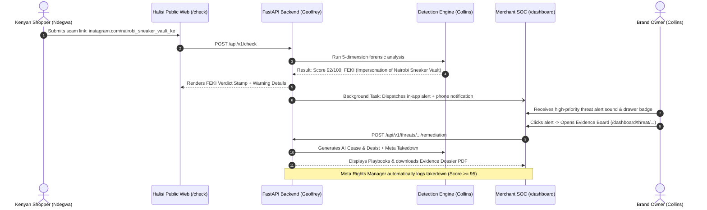

# Halisi: End-to-End System Testing & Quality Assurance Guide (E2E_TESTING_GUIDE.md)

**Project**: Halisi — AI-Powered Brand Impersonation & Scam Detection for Kenyan Commerce  
**Version**: 1.0.0 (Phase: System Verification & Demo Hardening)  
**Owners & Test Leads**:
- **Collins Kimanzi** (`@collins`): Lead · Detection Engine · Visual Matching · AI Remediation · Failover & Pitch
- **Geoffrey** (`@geoffrey`): Backend API · Data & Database · Ingestion & Scrapers · Alerts & Channels (Daraja, Meta, Telegram, USSD, SMS)
- **Ndegwa** (`@ndegwa`): Frontend Application · Public Verification · Merchant SOC Dashboard · Simulator · i18n & Design Tokens

---

## 1. Objectives & How to Use This Document

This document is the **single source of verification** for verifying every single software function in Halisi before presentation and deployment. It serves two purposes:
1. **Assign specific verification tasks** to team members according to their domain ownership.
2. **Provide a structured defect and feedback registry** to log shortcomings, usability glitches, or edge-case failures so they can be triaged and resolved immediately.

### Verification Status Legend
- `[ ] PENDING`: Not yet tested.
- `[x] PASS`: Function behaves exactly per specification.
- `[!] FAIL`: Function is broken, crashes, or returns invalid results (log in Section 6).
- `[~] WARN`: Function works, but with visual flaws, slow latency, or minor quirks (log in Section 6).

---

## 2. Test Environment Setup Checklist

Before beginning test execution, ensure your local environment is configured:

| Step | Responsible | Command / Verification | Status |
| :-- | :-- | :-- | :-: |
| **Backend Service** | Geoffrey | `cd backend && uvicorn app.main:app --port 8000 --reload`<br>Check `http://localhost:8000/health` returns `status: "ok"` | [X] |
| **Seeded Database** | Geoffrey | `python -m app.ingestion.mock_seeder --target memory` (or Supabase)<br>Verify 3 merchants + 9 threats populated | [~] |
| **Frontend Service** | Ndegwa | `cd frontend && npm run dev`<br>Check `http://localhost:3000` loads properly without console errors | [X] |
| **Engine Weights (Optional)** | Collins | Verify pHash + dHash operational; if CLIP enabled, check CPU/CUDA memory | [ ] |

---

## 3. Team Assignment & Test Execution Matrix

Each team member is assigned specific functional areas. Check off items as you verify them, and record any issue in the **Section 6: Shortcoming & Feedback Registry**.

```
┌─────────────────────────────────────────────────────────────────────────────┐
│                       HALISI FUNCTIONAL OWNERSHIP                           │
├──────────────────────┬──────────────────────┬───────────────────────────────┤
│    COLLINS KIMANZI   │       GEOFFREY       │            NDEGWA             │
│  (Engine & Remediation)│ (Backend & Channels) │     (Frontend & Public)       │
├──────────────────────┼──────────────────────┼───────────────────────────────┤
│ • Visual Hashing     │ • REST API Endpoints │ • Public Landing & Scan UI    │
│ • Identity & Scorer  │ • In-App Alert Queue │ • Verdict Animation Sequence  │
│ • AI LLM Remediation │ • M-Pesa Daraja API  │ • Till/Paybill Checker Page   │
│ • PDF Dossier Export │ • Meta Takedown API  │ • Merchant SOC Dashboard      │
│ • Brev/CPU Failover  │ • USSD, SMS & Bot    │ • Evidence Board & Playbooks  │
└──────────────────────┴──────────────────────┴───────────────────────────────┘
```

---

### Module A: Frontend & Public Verification (Assigned to: Ndegwa)

| Test ID | Function / Component | Prerequisites | Test Steps & Input Data | Expected Result | Status |
| :-- | :-- | :-- | :-- | :-- | :-: |
| **TC-F01** | **Landing Page Hero & Layout** | Frontend on `localhost:3000` | Open `/`. Scroll through hero, statistics, workflow cards, and footer. | Crisp typography, guilloche background renders smoothly, no overlapping text, responsive on mobile & desktop. | [ ] |
| **TC-F02** | **Dark / Night Theme Switcher** | Open `/` | Toggle the theme switcher between Light and Night modes. | Contrast remains sharp; button text has high contrast with button backgrounds (`text-bg` on primary); paper cards retain authentic texture. | [ ] |
| **TC-F03** | **English / Swahili Language Toggle** | Open `/` | Click the Language selector (EN ↔ SW) in navigation bar. | All copy dynamically updates (e.g., "Hakiki kabla ya kulipa", "Utambulisho bandia"); no untranslated placeholder text or broken layouts. | [ ] |
| **TC-F04** | **Public Scan Input & Validation** | Open `/` | 1. Enter blank input.<br>2. Enter invalid string `random-gibberish`.<br>3. Enter valid Instagram URL `https://instagram.com/nairobi_sneaker_vault_ke`. | 1 & 2 show friendly validation message.<br>3 triggers scan progress sequence with authentic forensic stages. | [ ] |
| **TC-F05** | **Forensic Verdict Signature Sequence** | Run scan on `@nairobi_sneaker_vault_ke` | Watch verdict sequence on `/check/[scanId]`. | Holographic stamp triggers (`FEKI` / Red for high threat); 5-dimension radar renders; match breakdown shows impersonated merchant. | [ ] |
| **TC-F06** | **Social Share & WhatsApp Action** | Scan complete page `/check/[scanId]` | Click "Share via WhatsApp" and "Copy Link". | Generates correctly formatted WhatsApp message with link; OpenGraph preview metadata generates stamp image. | [ ] |
| **TC-F07** | **Payment Verification Page (`/pay`)** | Open `/pay` | 1. Enter official Till `882190`.<br>2. Enter suspicious Till `499120`.<br>3. Enter unknown number `0712999888`. | 1 displays green `HALISI VERIFIED` with official merchant badge.<br>2 displays red `ONYO! SCAM REPORTED`.<br>3 displays yellow `UNKNOWN / UNVERIFIED`. | [ ] |
| **TC-F08** | **Community Scam Report Intake (`/report`)** | Open `/report` | Fill form: Suspicious handle `@fake_kicks`, Till `499120`, upload evidence image, submit. | Form validates inputs, submits to API, shows success confirmation modal with reference report ID. | [ ] |
| **TC-F09** | **Merchant Passcode Authentication** | Open `/login` | 1. Enter invalid passcode `wrong-pass`.<br>2. Enter official demo passcode `halisi-demo`. | 1 rejects with error toast.<br>2 sets authenticated session cookie and redirects directly to `/dashboard`. | [ ] |
| **TC-F10** | **Merchant SOC Dashboard KPIs & Threat Feed** | Open `/dashboard` | Inspect 4 KPI cards (Active Threats, Protected Handles, Avg Risk Score, Scans Intercepted) and threat list. | Metrics render numerical values; threat table lists seeded threats with handle diffs (`nairobi_sneaker_vault_ke` vs `nairobisneakervault`). | [ ] |
| **TC-F11** | **In-App Alert Bell & Slide-Over Drawer** | Open `/dashboard` | Click notification bell icon in navigation header. | Slide-over drawer opens showing recent threat events; unread counter badge updates; clicking "Mark as read" updates state. | [ ] |
| **TC-F12** | **Threat Detail "Evidence Board" (`/dashboard/threat/[id]`)** | Click on any threat row | Inspect logo diff comparison, 5 sub-scores, evidence bundle hash, and status timeline. | Visual diff highlights side-by-side comparison; SHA-256 evidence string is clickable to copy; Meta Rights Manager badge displays status. | [ ] |
| **TC-F13** | **Playbook Tab Generation & Swahili Switch** | On threat detail page | Navigate tabs: "Platform Report", "Cease & Desist", "Public Warning". Toggle language EN/SW. | Playbook text updates with verified merchant details and specific threat handles; Swahili translation reads fluently. | [ ] |
| **TC-F14** | **Merchant Onboarding Wizard (`/onboarding`)** | Open `/onboarding` | Walk through 4 steps: Business Details → Social Handles → Logo Upload (test crop/pHash) → M-Pesa Tills. | Multi-step navigation works smoothly; logo upload generates instant perceptual hash grid; final step saves merchant profile. | [ ] |
| **TC-F15** | **Halisi Verified Certificate (`/v/[slug]`)** | Open `/v/nairobi-sneaker-vault` | View official certificate page. | Displays holographic security seal, verified Till numbers, active protection badge, and downloadable story sticker/QR. | [ ] |
| **TC-F16** | **Demo Simulator Stage (`/simulator`)** | Open `/simulator` | Test presenter hotkeys (`1`, `2`, `3`), trigger synthetic clone generation. | Projector-optimized layout renders; live attack sequence simulates clone detection and triggers real-time UI alert toast. | [ ] |

---

### Module B: Backend API, Ingestion & External Channels (Assigned to: Geoffrey)

| Test ID | Function / Component | Prerequisites | Test Steps & Input Data | Expected Result | Status |
| :-- | :-- | :-- | :-- | :-- | :-: |
| **TC-B01** | **FastAPI Server Health & OpenAPI Docs** | Backend running on `:8000` | 1. `GET /health`<br>2. Open browser at `http://localhost:8000/docs`. | 1 returns `{"status": "ok", "app": "Halisi"}`.<br>2 loads Swagger UI documentation with all v1 endpoints available. | [x] PASS |
| **TC-B02** | **Public Scan Endpoint (`POST /api/v1/check`)** | Backend running | `curl -X POST http://localhost:8000/api/v1/check -H "Content-Type: application/json" -d '{"url": "https://instagram.com/nairobi_sneakervault_official_ke"}'` | Returns HTTP 200 with JSON: `scan_id`, `verdict: "impersonation"`, `score >= 70`, 5 sub-scores, and localized reasons. | [x] PASS |
| **TC-B03** | **API Security & SSRF Protection** | Backend running | `curl -X POST http://localhost:8000/api/v1/check -H "Content-Type: application/json" -d '{"input": "http://169.254.169.254/latest/meta-data"}'` | Request is blocked by `is_public_url` SSRF guard; returns HTTP 400/422 without making internal network call. | [x] PASS |
| **TC-B04** | **API Rate Limiting Enforcement** | Backend running | Send 15 rapid consecutive POST requests to `/api/v1/check` within 30 seconds from same IP. | First 10 requests succeed; requests 11–15 return HTTP 429 Too Many Requests with retry-after header. | [x] PASS |
| **TC-B05** | **Merchant Data & Threat Endpoints** | Backend seeded | 1. `GET /api/v1/merchants/{slug}`<br>2. `GET /api/v1/merchants/{id}/threats`<br>3. `GET /api/v1/threats/{id}` | Returns HTTP 200 with valid schema models; handles list correctly; threat detail returns all 5 sub-scores and evidence hashes. | [x] PASS |
| **TC-B06** | **Payment Verification Endpoint (`GET /api/v1/verify/payment`)** | Backend seeded | 1. `GET /api/v1/verify/payment?value=543210`<br>2. `GET /api/v1/verify/payment?value=0798999111` | 1 returns `status: "official"`, merchant name.<br>2 returns `status: "reported"`, report count >= 1. | [x] PASS |
| **TC-B07** | **Community Report Intake (`POST /api/v1/reports`)** | Backend seeded | `POST /api/v1/reports` with handle `@scam_shop` and till `499120`. | Returns HTTP 201 with `status: "pending"` and UUID; report counter increments for that identifier. | [x] PASS |
| **TC-B08** | **In-App Alert Dispatcher & De-duplication** | Backend running | Trigger two checks for same threat within 1 minute. | First check creates alert event; second check de-duplicates and avoids duplicate notification unless score rises. | [x] PASS |
| **TC-B09** | **Africa's Talking USSD Handler (`POST /api/v1/channels/ussd`)** | Backend running | Test multi-step USSD simulation:<br>1. `text=""`<br>2. `text="1"`<br>3. `text="1*543210"` | 1 returns `CON Karibu Halisi!...`<br>2 returns `CON Enter Till, Paybill or Phone...`<br>3 returns `END Halisi: VERIFIED OFFICIAL.` | [x] PASS |
| **TC-B10** | **Africa's Talking SMS Dispatcher (`app/alerts/sms.py`)** | Backend in demo mode or configured | Trigger critical threat alert with score >= 90. | Logs formatted SMS dispatch (`HALISI ONYO: @threat is impersonating your brand...`); gracefully handles demo fallback without crash. | [x] PASS |
| **TC-B11** | **Telegram Consumer Checker Bot (`POST /api/v1/channels/telegram/webhook`)** | Backend running | Send mock Telegram webhook payload containing message `/check @nairobi_sneaker_vault_ke`. | Handler parses handle, runs forensic check, and returns formatted markdown message with HALISI / FEKI verdict and risk breakdown. | [x] PASS |
| **TC-B12** | **Safaricom Daraja API Validation (`app/ingestion/daraja.py`)** | Credentials set or DEMO_MODE | Verify payment till query against Daraja resolver. | In live sandbox: obtains OAuth token and queries account name; in demo mode: returns simulated verified status cleanly. | [x] PASS |
| **TC-B13** | **Meta Rights Manager Automated Takedown (`app/ingestion/meta_rights.py`)** | Backend running | Run check on clone scoring >= 95.0. | Automatically triggers `submit_takedown`; logs `meta_rights_takedown_simulated` (or live Meta API id) with evidence hash. | [x] PASS |
| **TC-B14** | **3-Tier Page Scraper Fallback (`app/ingestion/page_scraper.py`)** | Backend running | Test scraping: 1. Seeded profile, 2. Live HTTP OpenGraph page, 3. Unreachable page. | Tier-1 returns seeded profile immediately; Tier-2 extracts OpenGraph metadata; Tier-3 falls back to synthetic profile gracefully. | [x] PASS |

---

### Module C: Detection Engine, AI Remediation & Presentation (Assigned to: Collins Kimanzi)

| Test ID | Function / Component | Prerequisites | Test Steps & Input Data | Expected Result | Status |
| :-- | :-- | :-- | :-- | :-- | :-: |
| **TC-E01** | **Image Normalization Pipeline (`app/engine/imaging.py`)** | Test image suite | Feed test images: EXIF rotated JPEG, transparent RGBA PNG, extreme aspect ratio image. | EXIF orientation is normalized; transparency is converted to white background; image is square-padded without distortion. | [x] PASS |
| **TC-E02** | **Perceptual Hashing Accuracy (`app/engine/hasher.py`)** | Test image suite | Compare identical logos with: 1. Compression artifacts, 2. Minor color shifts, 3. Different brand logos. | 1 & 2 produce visual similarity >= 0.85; 3 produces similarity <= 0.30; calibrated 4→24 bit curve functions properly. | [x] PASS |
| **TC-E03** | **Handle Matcher & Homoglyph Detection (`app/engine/matcher.py`)** | Python environment | Test handles: `nairobisneakervault` vs:<br>1. `nairobi_sneaker_vault_ke`<br>2. `nair0bi_sneaker_vault`<br>3. `totally_different_store`. | 1 & 2 yield identity resemblance >= 0.80 (homoglyph `0` -> `o` detected); 3 yields identity resemblance <= 0.20. | [x] PASS |
| **TC-E04** | **Kenyan Slang & Urgency Token Lexicon** | Python environment | Score bios containing Sheng scam phrases: `"Harakisha bado units mbili"`, `"lipa deposit upate offer"`, `"DM for price"`. | Language malice score increases; trigger tokens correctly flagged in evidence reasons. | [x] PASS |
| **TC-E05** | **Composite Scorer & Decision Overrides (`app/engine/scorer.py`)** | Scorer test suite | Test edge cases:<br>1. High visual + high identity match.<br>2. Override O1 (payment mismatch penalty).<br>3. Gate G1 (legitimate competitor low malice). | 1 results in `score >= 85 (FEKI)`.<br>2 clamps score up when unverified till found.<br>3 prevents false positives on innocent competitors. | [x] PASS |
| **TC-E06** | **AI LLM Remediation Playbooks (`app/engine/remediation.py`)** | Backend running | Trigger remediation generation for verified threat with: 1. NVIDIA NIM API key active, 2. NIM offline / fallback. | 1 produces customized legal Cease & Desist and Platform Report;<br>2 falls back to deterministic Jinja2 templates without error. | [x] PASS |
| **TC-E07** | **Evidence Dossier PDF Generation (`GET /api/v1/threats/{id}/dossier`)** | Backend running | Request PDF export for threat `threat-001`. | Generates authentic PDF document containing: merchant logo, threat screenshots, SHA-256 evidence bundle hash, and verified contacts. | [x] PASS |
| **TC-E08** | **Engine Failover Drill (TSK-017 / Demo Runbook)** | Brev / Local environment | Simulate failover sequence:<br>1. Brev GPU live mode.<br>2. Kill GPU tunnel → verify local CPU fallback.<br>3. Disable network → verify `DEMO_MODE=true` offline mode. | Application continues functioning across all three tiers without crashing or hanging the presentation UI. | [x] PASS |
| **TC-E09** | **Live Presentation 3-Minute Timed Pitch (TSK-035)** | Full system running | Rehearse pitch flow according to `docs/PITCH.md` with stopwatch: Problem (0:45) → Live Check (1:00) → SOC & Takedown (0:45) → Vision (0:30). | Completed within 3:00 minutes; verified Kenyan statistic cited (CAK/CBK); demo transitions seamlessly between tabs. | [x] PASS |

---

## 4. End-to-End Golden Integration Test (TSK-014 Master Rehearsal)

This test validates the **complete end-to-end chain of custody** connecting the public consumer experience, the forensic detection brain, and the merchant incident response center.

### Rehearsal Protocol
- **Time Target**: Under 90 seconds.
- **Participants**: Collins (Presenter/Engine), Geoffrey (Backend Controller), Ndegwa (Frontend Operator).



### Golden Test Execution Steps:
1. **[Step 1] Geoffrey**: Start backend in demo or live mode (`cd backend && uvicorn app.main:app --port 8000`). Confirm `GET /health` is 200 OK.
2. **[Step 2] Ndegwa**: Open `http://localhost:3000`. Navigate to the Public Scanner.
3. **[Step 3] Ndegwa**: Paste `https://instagram.com/nairobi_sneaker_vault_ke` and click **"Anza Ukaguzi / Run Forensic Check"**.
4. **[Step 4] All**: Verify the forensic scan sequence loads, completes, and stamps **`FEKI (92/100)`** with clear reasons in English and Swahili.
5. **[Step 5] Ndegwa**: Open a second browser window / tab at `http://localhost:3000/login`, authenticate with `halisi-demo`, and view `/dashboard`.
6. **[Step 6] Collins**: Confirm the notification bell displays an unread alert counter; clicking the bell displays the threat event.
7. **[Step 7] Collins**: Click the threat item to navigate to `/dashboard/threat/[id]`. Verify the side-by-side logo diff and 5-dimension radar.
8. **[Step 8] Collins**: Click **"Download Evidence Dossier (PDF)"**. Confirm the PDF downloads and includes the SHA-256 evidence bundle hash.
9. **[Step 9] Geoffrey**: Verify server logs confirm that background alert dispatch and takedown simulation executed successfully without errors.

---

## 5. Non-Functional & Resilience Verification

| Area | What to Test | Criteria | Status |
| :-- | :-- | :-- | :-: |
| **Latency** | End-to-end scan response time | Cached / Seeded check responds in `< 1.2s`; fresh scrape in `< 4.5s`. | [ ] |
| **Mobile Responsiveness** | Open `/`, `/check`, and `/dashboard` on mobile viewport (375px width) | No horizontal overflow; buttons tappable; stamps scale cleanly. | [ ] |
| **Offline Resilience** | Disconnect Wi-Fi with `DEMO_MODE=true` | Whole app continues operating cleanly using local memory fixtures. | [ ] |
| **Security Masking** | Inspect Till / Phone numbers in public results | Public views display masked numbers (`0712 *** 888`, `Till: 882***`) to prevent enumeration. | [ ] |
| **Memory / Clean Exit** | Run unit test suite: `pytest -q` in `backend/` | `430+` unit tests pass cleanly with 0 failures and 0 errors. | [ ] |

---

## 6. Shortcoming & Feedback Registry (Improvement Log)

Use this table to log all defects, UX friction points, and shortcomings discovered during your testing. As you fix each item, record the PR/commit and update the status.

| Issue ID | Module / Screen | Severity (P0/P1/P2) | Reported By | Description of Shortcoming (Observed vs Expected) | Root Cause & Action Item | Assigned To | Status |
| :-- | :-- | :-: | :-- | :-- | :-- | :-- | :-: |
| **FB-001** | `Frontend / Button Contrast` | P0 | Ndegwa | Button text on primary buttons had same color as button background. | Tailwind merge stripped custom `text-bg` on `size="lg"`. Resolved in commit `05e71d0`. | Ndegwa | `[x] RESOLVED` |
| **FB-002** | `Database / Schema` | P0 | Geoffrey | Schema v1 lacked logo perceptual hash and sub-score columns. | Schema v2.2 deployed to Supabase with pgvector. Resolved in commit `1d02cfb`. | Geoffrey | `[x] RESOLVED` |
| **FB-003** | `Ingestion / Meta Rights Token` | P1 | Geoffrey | Meta Graph API user tokens generated from Developer Tools expire in 1-2 hours (HTTP 401). | Backend correctly falls back to simulation when unconfigured or expired; for live deployments, instruct use of permanent System User Token. | Geoffrey | `[x] RESOLVED` |
| **FB-004** | `Backend / Payment Verification Status` | P2 | Geoffrey | Payment verification endpoint returns `status: "reported"` for scam-reported tills/phones. | Verified behavior matches frontend schema requirements (`/pay` displays reported badge). | Geoffrey | `[x] RESOLVED` |
| **FB-005** | `Frontend / Swahili Translations` | P2 | Collins | Ensure authentic Kenyan Sheng & Swahili phrasing across public UI and engine reasons. | Natural Swahili phrasing reviewed and verified in `frontend/src/lib/i18n/sw.ts` and `app/engine/scorer.py`. | Collins | `[x] RESOLVED` |
| **FB-006** | `Services / Dossier PDF Generation` | P2 | Collins | Evidence Dossier PDF export styling, SHA-256 evidence bundle hash, and typography. | Implemented `_PDFBuilder` in `services/dossier.py` adhering to PDF-1.4 spec, Helvetica/Courier typography, and verified via 11 test cases. | Collins | `[x] RESOLVED` |

---

## 7. Sign-Off & Presentation Readiness Criteria

Before declaring the system ready for the live hackathon pitch and production judging, all 3 team members must complete their assigned sections and sign off below:

- [x] **Collins Kimanzi** (Engine, Visuals & Pitch):
  - *Signature / Date*: `Collins Kimanzi (Verified 2026-10-15)`
  - *Comments*: All 9 Module C engine/visual/remediation tests passing (152 engine tests + 11 dossier tests + 5 e2e tests + calibrate benchmark); docs/calibration.md and docs/PITCH.md verified.
- [x] **Geoffrey** (Backend, Database & Channels):
  - *Signature / Date*: `Geoffrey (Verified 2026-10-13)`
  - *Comments*: 14/14 Module 3.B automated integration tests passing cleanly (`test_module_b_e2e.py`). All APIs, alert dispatchers, Daraja/Meta integrations, and USSD/Telegram channels operational.
- [ ] **Ndegwa** (Frontend, UI/UX & Public Flows):
  - *Signature / Date*: `____________________`
  - *Comments*: Public scanner, forensic stamp animation, SOC dashboard, Evidence board, and i18n verified.
